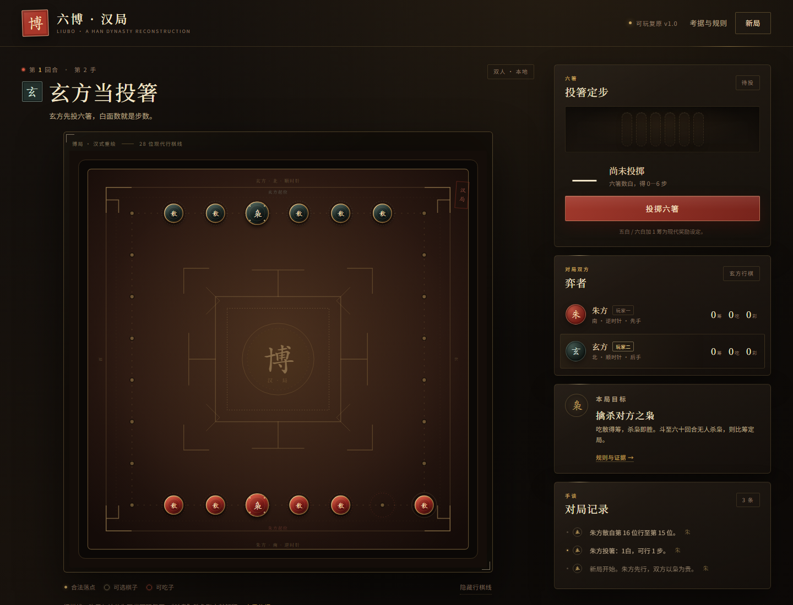

# 六博 · 汉局

一款以汉代六博为主题的**可玩网页游戏与数字博物馆**。支持双人本地对弈、人机对弈、完整规则判定、考据证据面板、桌面与手机布局。

**在线游玩**：[https://joge-xi.github.io/liubo-hanju/](https://joge-xi.github.io/liubo-hanju/)  
**GitHub 仓库**：[https://github.com/joge-xi/liubo-hanju](https://github.com/joge-xi/liubo-hanju)

[](https://github.com/joge-xi/liubo-hanju/actions/workflows/pages.yml)

> **重要声明**
>
> 六博的完整规则已经失传。本项目不是“汉代原制标准答案”，而是一套有明确来源标注的**现代可玩复原**。所选方案名为 **汉局·杀枭竞速 v1.0.0**：以“六箸十二棋”“枭贵而必杀枭”“五白”“争道”等文献线索为骨架，把无法确认的路线、吃子、计分与回合上限明确标为现代设定。



## 1. 快速启动

要求：Node.js 20 或更高版本。项目**没有第三方运行依赖**，无需数据库、服务器或 API Key。

```powershell
cd "D:\ai\dsh 短剧\liubo-hanju"
node scripts/serve.mjs
```

浏览器打开：

```text
http://127.0.0.1:4173/
```

也可以：

```powershell
npm.cmd start
```

> Windows PowerShell 若禁止运行 `npm.ps1`，请使用 `npm.cmd`，或直接使用上面的 `node scripts/serve.mjs`。

自定义端口：

```powershell
node scripts/serve.mjs --port 8080
```

**不要直接双击 `index.html`**：项目使用原生 ES Modules，必须通过 HTTP 访问，否则浏览器会因模块加载策略阻止脚本。

### 手机访问（同一 Wi-Fi）

手机不能用 `127.0.0.1`，因为这个地址指手机自己。服务器已改为默认监听 `0.0.0.0`，启动时会在终端打印电脑的局域网 IP。

这台电脑的 Wi-Fi 被 Windows 标为“公用网络”，并且防火墙明确阻止了 `node.exe` 入站；但 DSH 自带的 Python 已被允许入站。因此提供了手机访问专用入口：

```powershell
cd "D:\ai\dsh 短剧\liubo-hanju"
.\scripts\start-phone.cmd
```

或：

```powershell
npm.cmd run start:phone
```

终端会显示类似：

```text
手机访问（手机与电脑需连同一个 Wi-Fi）：
  http://10.194.157.160:4173
```

在手机上打开终端显示的那个 `http://<电脑局域网IP>:4173/`。

当前这台电脑本次连接得到的地址是：

```text
http://10.194.157.160:4173/
```

> 局域网 IP 由路由器分配，重连 Wi-Fi 后可能改变。请以 `start-phone.cmd` 或 `node scripts/serve.mjs` 启动时打印的地址为准，也可在电脑上运行 `ipconfig` 查看 WLAN 的 IPv4 地址。
>
> 若手机仍打不开：确认手机和电脑连的是同一个 Wi-Fi（不是访客网络），并检查路由器是否开启了“AP 隔离”；必要时关闭电脑上的 VPN/代理后再试。
>
> 为什么手机入口用 Python：这台电脑的 Windows 防火墙允许 DSH Python 入站、阻止 Node.js 入站。`scripts/serve_lan.py` 只提供同一套静态文件，不改变游戏内容。若你以后在防火墙中允许 Node.js 入站，也可以直接用 `npm.cmd start` 让手机访问。

## 2. 玩法与操作

### 模式

- **双人对弈**：同一台设备轮流操作，朱方先手。
- **人机对弈**：玩家执朱方，电脑执玄方。电脑只从规则引擎返回的合法着法中选点。
- 开始页选择模式；对局中可通过“新局 / 切换模式”重新选择，通过“重开本局”保持当前模式重置。

### 一局怎么玩

1. 点击 **投掷六箸**。六根箸翻转，白面数就是步数（0—6）。
2. 点选有光晕的己方棋子，再点金色合法落点。
3. 可以越过任意棋子；不能落在己方棋子上；精确落到敌方棋子上即吃掉它。
4. 吃散得 1 筹；**吃掉对方的枭立即获胜**。
5. 若投出 0 白或没有任何合法落点，点击“无棋可走 · 过手”。
6. 60 回合内无人杀枭，则比较博筹；同筹为和局。

**操作反馈**：非法落点会被规则引擎拒绝并提示；当前玩家、回合、投掷结果、吃子与得分都有独立显示。

### 快捷测试参数

- `?seed=12345`：使投箸结果可复现，便于调试。
- `?debug=1`：仅在本地测试时注册一个固定“杀枭”局面入口，不参与正常开局。

```text
http://127.0.0.1:4173/?seed=12345
http://127.0.0.1:4173/?debug=1
```

## 3. 本版规则与证据边界

### 3.1 直接采用的完整方案

**汉局·杀枭竞速 v1.0.0**

- 12 枚棋子，双方各 6 枚：1 枭 + 5 散（复原假说）。
- 朱方居南、逆时针；玄方居北、顺时针（现代设定）。
- 28 位环形博道，六枚棋子占己方连续六位（现代设定）。
- 六箸投掷，数白面，得 0—6 步（文献线索 + 现代解释）。
- 每次精确走投出的步数；可越子，不可落己方子，落敌方子即吃（现代设定）。
- 吃散得 1 筹；杀枭立即获胜（“杀枭”取文献解释）。
- 五白/六白加 1 筹（现代奖励）。
- 60 回合上限，到时比筹，同筹和局（现代收束）。
- 人机对手使用启发式评分，只执行合法着法。

### 3.2 简短证据清单

| 规则要素 | 主要依据 | 定性 | 不确定性 |
|---|---|---|---|
| 六箸、十二棋 | 《说文解字》：“博，局戏也。六箸十二棊也。” | 文献明确 | 不能据此还原完整玩法 |
| 双方各六棋、一枭五散 | 十二棋总数 + “枭”的特殊称谓 + 考古所见两组棋子 | 学术假说 | “一枭五散”不是文献逐字分配 |
| 枭为贵、胜者必杀枭 | 《韩非子·外储说左下》：“博者贵枭，胜者必杀枭。” | 文献可推 | 原文是伦理类比，未必等同完整胜负规则 |
| 五白 | 《楚辞·招魂》：“成枭而牟，呼五白些。” | 文献线索 | 具体奖励未知，本作加筹是现代设定 |
| 分曹并进、争道 | 《楚辞·招魂》；《史记·刺客列传》《史记·吴王濞列传》 | 文献可推 | “道”的走向与争夺方式无法唯一还原 |
| 博局与 T/L/V 纹样 | 汉代博局、博局纹镜、尹湾汉墓《博局占》 | 考古旁证 | 纹样与行棋点的对应关系待考 |
| 28 位路线、方向、起点 | 无直接文献依据 | 现代简化 | 全作最大的人工设定之一 |
| 吃子、博筹数值、回合上限 | 无可靠可执行记载 | 现代简化 | 不能冒充汉代原制 |

完整的 16 条证据记录、证据强度、引文与参考书目在游戏内 **“考据与规则 → 证据清单 / 参考与局限”**。数据结构在 `src/data/museum.js`，便于逐条修订。

### 3.3 网络检索与 CMU Liubo Lab

2026-10-28 初次检索时，搜索端点返回 `fetch failed`，外部域名被解析到 `198.19.x.x` 非公网地址，HTTPS 也无法完成。2026-10-29 网络恢复后，已实际核验：

- [CMU Liubo Lab · Liubo](https://projects.etc.cmu.edu/liubo-lab/liubo/)
- [CMU ETC · Liubo Lab 项目介绍](https://etc.cmu.edu/our-work/projects/finder/liubo-lab)

Liubo Lab 的公开页确认了 **双人、双方各六子、特殊棋子“枭”、博局、投具与博筹**；同时明确把 **行棋规则、棋盘变体和胜负条件** 列为 “What we don’t know”。项目还提到海昏侯墓出土了迄今最丰富的六博文字与着法记录，但本作尚未取得这批材料原文，也没有测试 Liubo Lab 的实际游戏 build。

因此：

- Liubo Lab 是本作重要的方法对照，**不是本作规则的依据或背书**；
- 本作的 28 位路线、吃子、计分与“杀枭即胜”仍明确标为现代可玩设定；
- 0—6 步、五白奖励等仍属于解释或现代补充，不能写成已证实的汉代原制。

## 4. 测试结果

### 4.1 规则引擎与 AI

```powershell
npm.cmd test
```

若在禁止子进程管道的受限沙箱中运行（例如某些 CI 沙箱），改用同进程模式：

```powershell
npm.cmd run test:restricted
# 等价于：node --test --test-isolation=none
```

最近一次结果：**27 项全部通过**。默认 `node --test` 与 `test:restricted` 同进程模式均已验证通过。

覆盖：

- 28 位博道、双方起点与反向行棋；
- 六箸计数、六白/全黑、可复现随机；
- 12 棋初始化、位置唯一、枭的分布；
- 精确步数、越子、禁止落己方子；
- 吃散计分、杀枭终局、不能继续行动；
- 0 白过手、有合法着法时禁止过手；
- 五白/六白奖励；
- 60 回合上限的和局与按筹判胜；
- 重开状态独立、原状态不被修改；
- 200 局随机推演合法落点约束；
- AI 只返回合法着法、优先杀枭、AI 对 AI 20 局全部结束。

### 4.2 真实浏览器测试

```powershell
npm.cmd run test:browser
# 等价于：node scripts/browser-smoke.mjs
```

最近一次结果：**14 项浏览器检查全部通过，0 个 JavaScript 异常**。使用本机 Microsoft Edge `156.0.4314.50` 无头模式，在 `1440×1100` 与 `390×844` 视口下运行。

检查内容包括：

- 首屏、开场说明、12 枚棋子真实渲染；
- 双人模式启动、当前玩家提示、过手按钮按阶段隐藏；
- 考据手册四章、16 条证据；
- 投掷动画结束后进入合法行棋阶段；
- 选子、合法落点、行棋、回合切换；
- 未投箸时点击棋子被阻止；
- 重新开始清空状态；
- 模式切换到人机，AI 自动投箸、行棋并交回回合；
- 固定测试局面杀枭，终局面板正确显示；
- 桌面与手机均无横向溢出。

截图：

- [桌面对局](artifacts/liubo-hanju-desktop.png)
- [考据手册](artifacts/liubo-hanju-guide.png)
- [终局面板](artifacts/liubo-hanju-result.png)
- [手机首屏](artifacts/liubo-hanju-mobile.png)
- [手机对局](artifacts/liubo-hanju-mobile-board.png)

> 当前开发环境的文件沙箱会阻断 Chromium 的 Mojo 命名管道，因此无头浏览器测试需在普通桌面会话或一次性更宽权限下执行。这不是游戏本身的运行要求；普通用户只需用浏览器打开本地服务。

## 5. 项目结构

```text
liubo-hanju/
├─ index.html                 页面骨架与弹窗
├─ favicon.svg
├─ package.json               无第三方依赖；start / test / test:browser
├─ src/
│  ├─ main.js                 浏览器交互、动画、模式、人机调度
│  ├─ styles/main.css         数字博物馆视觉、响应式布局
│  ├─ game/
│  │  ├─ board.js             28 位博道几何、起点、方向
│  │  ├─ dice.js              六箸投掷与可注入随机数
│  │  ├─ engine.js            纯规则引擎（无 DOM）
│  │  ├─ ai.js                只从合法着法中选点的人机启发式
│  │  └─ ruleset.js           规则版本、参数、变更记录、已知缺口
│  ├─ data/
│  │  └─ museum.js            16 条证据、展廊、参考书目、网络状态
│  └─ ui/
│     ├─ boardView.js         SVG 博局与棋子渲染
│     └─ guideView.js         考据手册四章渲染
├─ tests/                     board / dice / engine / ai 测试
├─ scripts/
│  ├─ serve.mjs               零依赖 Node 静态服务器（默认监听 0.0.0.0）
│  ├─ serve_lan.py            手机访问备用静态服务器（Python 标准库）
│  ├─ start-phone.ps1         自动选择防火墙已放行的服务程序
│  ├─ start-phone.cmd         手机访问一键入口
│  ├─ build-static.mjs        生成可部署的 dist/
│  ├─ start-public.mjs        临时公网隧道（serveo.net）
│  ├─ start-public.cmd        临时公网入口一键脚本
│  └─ browser-smoke.mjs       CDP 真实浏览器验收
├─ .github/workflows/pages.yml  GitHub Pages 自动部署
├─ netlify.toml               Netlify 构建配置
├─ vercel.json                Vercel 构建配置
├─ wrangler.toml              Cloudflare Pages 配置
├─ dist/                      构建产物（已忽略 Git）
├─ artifacts/                 截图与 liubo-hanju-static.zip
└─ README.md
```

## 6. 以后怎样改规则

规则没有散落在界面代码里。建议按以下顺序修改：

1. **参数与版本**：`src/game/ruleset.js`
   - 增加版本号、日期、changelog、已知缺口；
   - 修改棋子分配、投掷奖励、回合上限等。
2. **棋盘几何**：`src/game/board.js`
   - 若采用新路线、起点、方向，先改这里；
   - 同步调整 `BOARD.track`、`HOME_POSITIONS`、`OWL_START`、`DIRECTIONS`。
3. **规则行为**：`src/game/engine.js`
   - 合法性、吃子、计分、胜负、过手；
   - 继续保证纯函数、返回新状态。
4. **考据表述**：`src/data/museum.js`
   - 证据标签、引文、来源、局限；
   - 规则改动后必须同步更新“本作处理”和标签。
5. **测试**：`tests/`
   - 为每次规则变更新增失败用例，再改实现；
   - 最后重新运行规则测试和真实浏览器测试。

## 7. 仍需人工确认

1. **CMU Liubo Lab 与其他数字复原模型**：公开项目页已核验；仍需实际试玩其 build、阅读开发日志/评审论文，并取得海昏侯墓材料后逐项比较。
2. **文献版本校勘**：当前引文按通行标点本录入，未能核对善本、具体篇页和异文。
3. **考古细节**：马王堆、尹湾、满城及各地博具的器号、数量、组合与年代，应由考古报告或博物馆目录复核。
4. **“一枭五散”与“成枭”的解释**：需要更多文字学与规则史研究支持。
5. **行棋路线**：本作 28 位环线完全是可玩化设计，不应写入任何“复原原制”的结论。
6. **物理设备触控**：已用 390px 视口模拟测试，仍建议在真实手机与平板上试玩。
7. **无障碍**：已提供键盘可操作棋子/落点、ARIA 提示与减少动效支持，但仍建议完整屏幕阅读器与色觉测试。

## 8. 设计说明

- 视觉全部由 HTML/CSS/SVG 生成，无外部图片、字体或付费素材。
- 颜色取漆器、朱砂、旧金与竹简；棋盘保留中心方框与 T/L/V 类母题。
- 棋盘上的“行棋线”明确标注为现代设定，不被包装成考古结论。
- AI 是本地启发式，不调用任何在线模型或接口。

## 9. 让不在同一 Wi-Fi 的人访问

先说明：当前游戏是**纯前端**的本地双人/人机游戏。把网址发给别人，只会让每个人各自打开一局游戏，**不是两人在同一个房间里联机对弈**。真正的远程联机需要后端房间与 WebSocket，目前没有实现。

### 9.1 临时公网链接（最快）

```powershell
cd "D:\ai\dsh 短剧\liubo-hanju"
.\scripts\start-public.cmd
```

或：

```powershell
npm.cmd run start:public
```

脚本会：

1. 构建只含游戏运行文件的 `dist/`；
2. 在本机启动预览；
3. 通过 `serveo.net` 建立临时公网隧道，并打印一个 `https://……serveousercontent.com` 地址。

把这个 https 地址发给任何人即可，不需要同一 Wi-Fi。

注意事项：

- 第一次打开可能显示 Serveo 的安全提醒页，点击 **Continue to Site** 即可。
- 链接只在电脑、命令窗口和隧道保持运行时有效；重启后地址会改变。
- 只暴露 `dist/`，不会公开源码目录、测试、README 或本机文件。
- 临时隧道依赖第三方免费服务，适合演示，不适合长期发布。

### 9.2 永久发布到静态托管（推荐）

游戏没有后端，所有文件都是静态的，可以直接部署到任何静态托管。先生成构建：

```powershell
npm.cmd run build
```

构建输出为 `dist/`，只有 14 个运行文件。

**最简单：Netlify Drop**

- 已生成可直接上传的压缩包：[liubo-hanju-static.zip](artifacts/liubo-hanju-static.zip)
- 打开 [Netlify Drop](https://app.netlify.com/drop)，把 zip 拖进去，即可得到一个公网网址。
- 若用 Git 导入，仓库里的 `netlify.toml` 已配置构建命令和 `dist` 输出目录。

**Cloudflare Pages**

- 连接 Git 仓库；
- 构建命令：`node scripts/build-static.mjs`
- 输出目录：`dist`
- 仓库内的 `wrangler.toml` 可用于 `wrangler pages deploy dist`。

**Vercel**

- 导入仓库即可，`vercel.json` 已指定构建命令和输出目录；
- 或运行 `npx vercel --prod`。

**GitHub Pages**

1. 把 `liubo-hanju` 目录推送到 GitHub 仓库；
2. 仓库 Settings → Pages → Source 选择 **GitHub Actions**；
3. 推送到 `main` 后，`.github/workflows/pages.yml` 会自动构建并发布；
4. 页面地址形如 `https://<用户名>.github.io/<仓库名>/`。

> 静态托管方案不需要电脑一直开机，也不需要公网 IP。部署后，任何能上网的人都可以打开游戏。游戏不收集账号、棋局或个人信息。
>
> 如果真正需要“两个人在不同地点进入同一局并轮流落子”，需要新增后端房间、服务端规则校验、WebSocket 和持久化；这超出当前纯静态版本。

---

**项目路径**：`D:\ai\dsh 短剧\liubo-hanju`

**当前版本**：汉局·杀枭竞速 v1.0.0（2026-10-28）

**定位**：数字博物馆式可玩复原，不是已证实的汉代原制。

**测试环境说明**：本次验收在 Windows / Node 24 / Edge 156 下完成。规则测试在默认隔离与同进程模式下均通过；浏览器测试需要能够启动 Chromium 的桌面会话。普通本机开发不需要额外参数。
